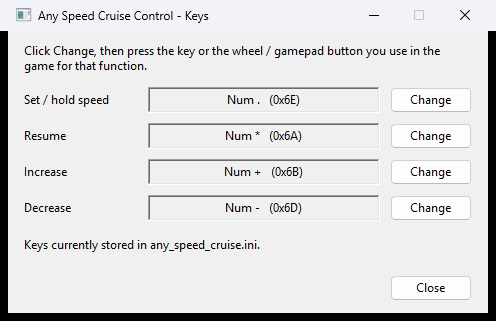

<p align="center">
  
</p>

<h1 align="center">ETS2 &amp; ATS – Any Speed Cruise</h1>

<p align="center">
  Cruise control that works below 30 km/h (20 mph) in
  <b>Euro Truck Simulator 2</b> and <b>American Truck Simulator</b>.
</p>

<p align="center">
  <b>English</b> ·
  <a href="docs/README.fr.md">Français</a> ·
  <a href="docs/README.de.md">Deutsch</a> ·
  <a href="docs/README.es.md">Español</a> ·
  <a href="docs/README.pl.md">Polski</a> ·
  <a href="docs/README.cs.md">Čeština</a>
</p>

---

## What it does

In both games, "set" and "resume" do nothing below 30 km/h (20 mph). That is
realistic, but trucks are slow to get going, and some of us like to drive on
cruise control all the way.

With this plugin your usual cruise control keys work at any speed:

| Key | Below the game's limit | Above it |
| --- | --- | --- |
| Cruise control (set) | The plugin holds your current speed with the throttle | The game does its usual job |
| Resume | The plugin accelerates to the last stored speed, even from a standstill | same |
| Increase / decrease | Changes the plugin's target (5 km/h steps by default) | same |

As soon as the truck is fast enough, the plugin switches on the game's real
cruise control and steps aside.

The plugin lets go of the throttle the moment you brake, press the cruise key
again, apply the parking brake, select reverse, stop the engine or open a menu.

## Why a plugin and not a regular mod

The 30 km/h limit is hardcoded in the game executable. No definition file
contains it, so a `.scs` mod cannot change it. This plugin uses the official
[SCS SDK](https://modding.scssoft.com/wiki/Documentation/Engine/SDK/Telemetry)
only (telemetry + input): it does not patch memory and does not modify any game
file.

## Install

1. Close the game.
2. Download the latest zip from [Releases](../../releases/latest).
3. Copy `any_speed_cruise.dll`, `any_speed_cruise.ini` and
   `any_speed_cruise_config.exe` into the game's `bin\win_x64\plugins` folder
   (create `plugins` if it does not exist), for example
   `...\steamapps\common\Euro Truck Simulator 2\bin\win_x64\plugins`.
4. Run `any_speed_cruise_config.exe` and tell it which keys you use (see below).
5. Start the game. It warns that SDK features are in use: this is normal for
   any plugin, just accept.

To uninstall, delete the three files.

## Choose your keys

<p align="center">
  
</p>

Run `any_speed_cruise_config.exe`, click **Change**, then press a keyboard key
or a wheel / gamepad button. The value is saved at once to
`any_speed_cruise.ini` (Esc cancels). The game reads the file when it starts.

The plugin only *watches* these keys: **the same key must be bound to the same
function in the game** (Options > Keys & Buttons).

Defaults: numpad `.` (set), `*` (resume), `+` and `-`. Numpad keys are only
recognised while Num Lock is on.

More settings (step, maximum throttle, handover speed, logging) are explained
in `any_speed_cruise.ini`.

## Good to know

- The dashboard cruise control light stays off while the plugin holds the
  speed; it comes on when the game takes over.
- The plugin only uses the throttle: it does not brake downhill.
- "Set" does nothing at a standstill; "resume" does.
- Up to 32 buttons per wheel / gamepad are supported. POV hats and mouse
  buttons are not.
- Not tested in TruckersMP; check their rules about plugins before using it
  there.

## Compatibility

| | Status |
| --- | --- |
| Euro Truck Simulator 2 1.62 | Tested, works |
| American Truck Simulator | Built for it (same SDK, 20 mph limit handled), **not tested yet** – feedback welcome |
| Future game versions | Expected to keep working: only the public SDK is used. See [Maintenance](#maintenance) |

Windows 64-bit only.

## Troubleshooting

The plugin writes lines starting with `[any_speed_cruise]` to
`Documents\Euro Truck Simulator 2\game.log.txt` (or
`Documents\American Truck Simulator\game.log.txt`): loading, taking control,
letting go.

- **No such line at all**: the DLL is not in `bin\win_x64\plugins`.
- **Loaded but the keys do nothing**: the keys in the ini are not the ones
  bound in the game, or Num Lock is off.

## Build from source

Requires [Zig](https://ziglang.org/) (used as a C++ compiler), e.g.
`scoop install zig`.

```powershell
.\build.ps1                 # build\any_speed_cruise.dll + any_speed_cruise_config.exe
.\install.ps1               # copies them to ETS2 (found through Steam)
.\install.ps1 -Game ats     # ... or to ATS
.\install.ps1 -GamePath "D:\Games\Euro Truck Simulator 2"
```

Layout:

- `src/any_speed_cruise.cpp` – the plugin
- `src/config_tool.cpp` – the key setup tool
- `third_party/scs_sdk_1_16` – SCS SDK headers (MIT, © SCS Software)

## Maintenance

Nothing should be needed when the game updates. If something breaks:

- **The game refuses the plugin**: look at `game.log.txt`. If the SDK API
  version changed, get the new SDK and rebuild.
- **The throttle no longer reacts**: check that the profile's `controls.sii`
  still contains `semantical.aforward`, `semantical.cruiectrl` and
  `semantical.cruiectrlres`. These are the names used in
  `src/any_speed_cruise.cpp`.

## Made by an AI

This whole project – plugin, setup tool, logo, documentation and translations –
was created by **Claude Fable 5.2** (Anthropic) in November 2026, at the
request of a player who tested it in the game. No human wrote or reviewed the
code line by line. Read it, test it, and use it at your own risk; issues and
pull requests are welcome.

## License

[MIT](LICENSE). The SCS SDK in `third_party` is © SCS Software, also MIT.

Not affiliated with or endorsed by SCS Software. Euro Truck Simulator 2 and
American Truck Simulator are trademarks of SCS Software.
