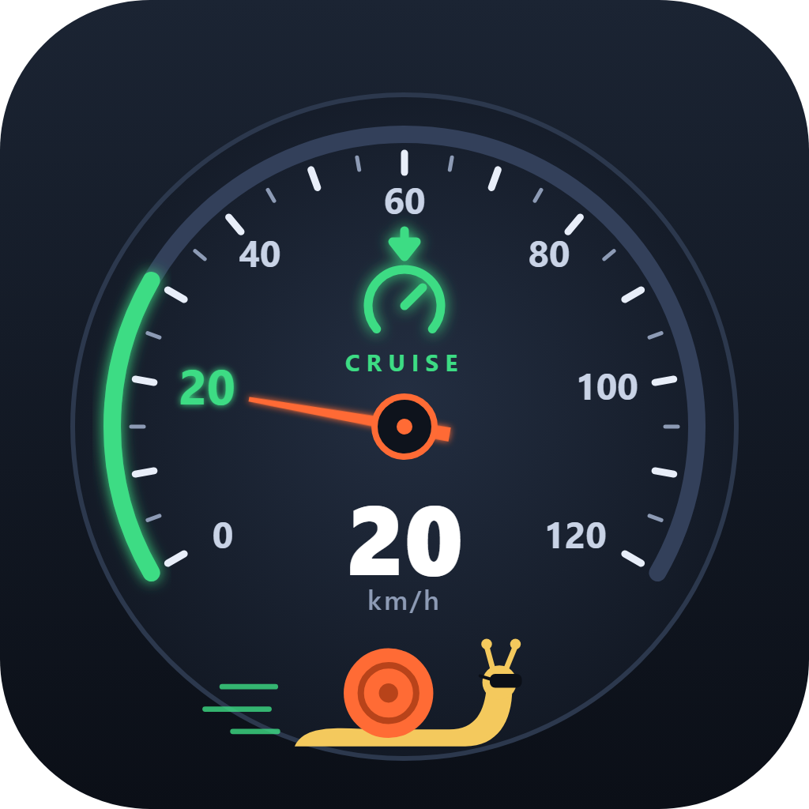
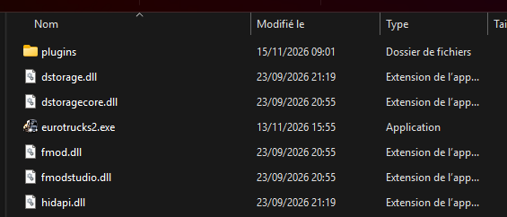
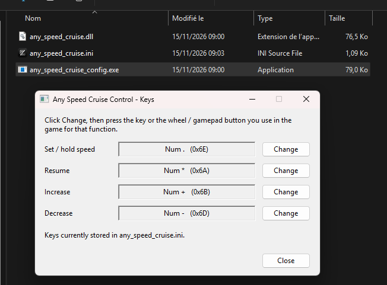
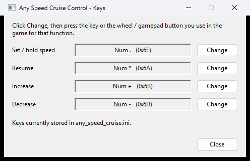

  

# ETS2 & ATS – Any Speed Cruise

[English](../README.md) · [Français](README.fr.md) · **Deutsch** · [Español](README.es.md) · [Polski](README.pl.md) · [Čeština](README.cs.md)

Ein Tempomat, der auch unter 30 km/h (20 mph) funktioniert – für
**Euro Truck Simulator 2** und **American Truck Simulator**.

  
  &nbsp;
  

## Was es macht

In beiden Spielen bewirken „Setzen“ und „Wiederaufnehmen“ unter 30 km/h
nichts. Das ist realistisch, aber Lkw beschleunigen langsam. Mit diesem Plugin
funktionieren deine gewohnten Tempomat-Tasten bei jeder Geschwindigkeit:

| Taste | Unter der Grenze des Spiels | Darüber |
| --- | --- | --- |
| Tempomat (Setzen) | Das Plugin hält die aktuelle Geschwindigkeit über das Gaspedal | Das Spiel arbeitet wie gewohnt |
| Wiederaufnehmen | Das Plugin beschleunigt auf die zuletzt gespeicherte Geschwindigkeit, auch aus dem Stand | wie gewohnt |
| Erhöhen / Verringern | Ändert den Sollwert des Plugins (standardmäßig 5 km/h) | wie gewohnt |

Sobald der Lkw schnell genug ist, schaltet das Plugin den echten Tempomat des
Spiels ein und zieht sich zurück. Es lässt das Gas sofort los, wenn du bremst,
die Tempomat-Taste erneut drückst, die Feststellbremse anziehst, den
Rückwärtsgang einlegst, den Motor abstellst oder ein Menü öffnest.

## Warum ein Plugin und keine Mod

Die 30-km/h-Grenze ist fest in der ausführbaren Datei des Spiels verankert;
eine `.scs`-Mod kann sie nicht ändern. Dieses Plugin nutzt ausschließlich das
offizielle SCS SDK und verändert weder den Speicher noch Spieldateien.

## Installation

1. Spiel beenden.
2. Das neueste Zip unter [Releases](../../../releases/latest) herunterladen.
3. `any_speed_cruise.dll`, `any_speed_cruise.ini` und
   `any_speed_cruise_config.exe` in den Ordner `bin\win_x64\plugins` des Spiels
   kopieren (`plugins` anlegen, falls er fehlt).
4. `any_speed_cruise_config.exe` starten und die eigenen Tasten festlegen.
5. Spiel starten und den Hinweis zu SDK-Funktionen bestätigen (bei jedem
   Plugin normal).

Zum Deinstallieren die drei Dateien löschen.

## Tasten festlegen

  

In `any_speed_cruise_config.exe` auf **Change** klicken und dann eine Taste
oder einen Lenkrad-/Gamepad-Knopf drücken. Der Wert wird sofort gespeichert
(Esc bricht ab) und beim nächsten Spielstart gelesen.

Das Plugin beobachtet diese Tasten nur: **Dieselbe Taste muss im Spiel
derselben Funktion zugewiesen sein** (Optionen > Tasten & Knöpfe).

Standard: Ziffernblock `.`, `*`, `+` und `-` – sie werden nur bei aktiviertem
Num Lock erkannt.

## Gut zu wissen

- Die Tempomat-Kontrollleuchte bleibt aus, solange das Plugin die
  Geschwindigkeit hält.
- Das Plugin nutzt nur das Gaspedal: Bergab bremst es nicht.
- „Setzen“ bewirkt im Stand nichts, „Wiederaufnehmen“ schon.
- Höchstens 32 Knöpfe pro Gerät; keine Coolie-Hats (POV) und keine Maustasten.
- Getestet mit ETS2 1.62. Für ATS gebaut, dort aber **noch nicht getestet**.

Fehlersuche, Kompilieren und Wartung: siehe [englisches README](../README.md).

## Von einer KI erstellt

Das gesamte Projekt – Plugin, Werkzeug, Logo, Dokumentation und
Übersetzungen – wurde im November 2026 von **Claude Fable 5.2** (Anthropic)
erstellt, im Auftrag eines Spielers, der es im Spiel getestet hat. Nutzung auf
eigene Gefahr. Lizenz: [MIT](../LICENSE). Nicht mit SCS Software verbunden.
